# EUC Planet

[](https://github.com/eried/eucplanet/releases)
[](LICENSE)
[](https://play.google.com/store/apps/details?id=com.eried.eucplanet)
[](https://testflight.apple.com/join/8VrhGCrm)
[](https://apps.garmin.com/apps/14c2d086-fcb5-4042-bd5b-034519d18a71)
[](docs/AMAZFIT_SETUP.md)
[](https://t.me/EUCPlanetApp)
[](https://eucstats.ried.no/)
[](https://eucviewer.ried.no/)
[](https://www.paypal.com/donate/?hosted_button_id=AEB2RPZHNRTKG)
[](https://github.com/eried/eucplanet/releases)

Open-source app for electric unicycles, on Android and iPhone: live telemetry,
turn-by-turn navigation, an on-screen overlay for video recording, and many
other integrations.
I don't want to pay to just enjoy a wheel I already own. No ads, no in-app
tracking, no subscriptions, no upselling, no features behind a paywall, no
telemetry phoned home.

## What wheels work?

I only own and ride a V14. Everything else gets done through collaboration with
riders who have the wheel.

| Status | Wheels |
|---|---|
| **Verified** | InMotion V14 (50GB / 50S), P6 |
| **Rider-tested** | InMotion V6, V8S · LeaperKim Lynx S, Oryx · NOSFET Aeon · Begode/Gotway Mten3, EX30, E20, Master · KingSong KS-16X, KS-18XL |
| **In test** | InMotion X1 · Begode/Gotway Master Pro, T3, T4, RS, RS-HT, EX, EX.N, EX2, MSP, MSX, Hero, XWay, Mten4, Mten5, MCM5 · LeaperKim Sherman, Sherman S, Sherman Max, Patton, Lynx, Abrams · NOSFET Apex, Aero, Xeno · KingSong S22, S20, S19, S18, S16, KS-14/16/18, F18P, F22P |
| **Waiting to be tested** | InMotion V12 HS / HT / Pro, and the rest of the V1 family: V5, V8, V8F, V10, V10F, V10S, V10T, V10FT, L6, Lively, Glide 3 · Ninebot Z6, Z10, plus legacy One E / E+ / S2 / Mini (read-only) |
| **Experimental** | InMotion V9, V11, V13 |

**NOSFET Apex, Aero or Xeno rider?** Your wheel now gets the same light and
headlight handling as the Aeon, and the Aero gets its speed alarm the Aeon
way. Please try the light tile and the speed alarm and tell us if they do what
the app says. Apex riders: the speed alarm stays on the older command until
someone captures it, because on some wheels that setting slot is tiltback.
[Open an issue](https://github.com/eried/eucplanet/issues) with your model and firmware.

Help with your wheel, check the [BLE capture guide](docs/BLE_CAPTURE_GUIDE.md).
Already connects but a reading looks wrong? See the [in-app diagnostics guide](docs/DIAGNOSTICS_GUIDE.md).

---

## Gallery

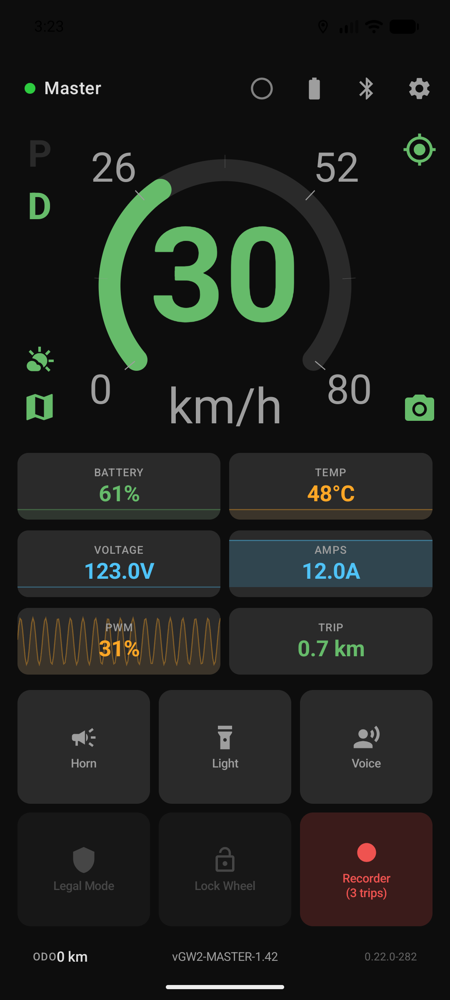 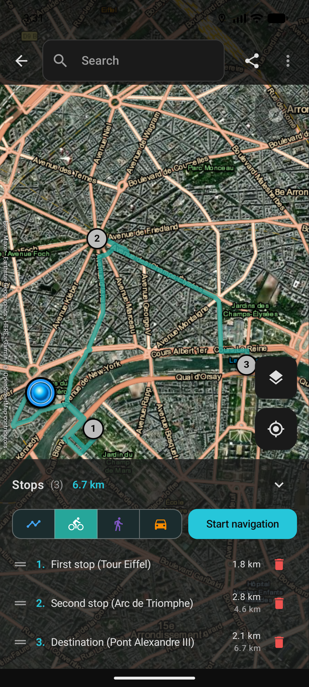 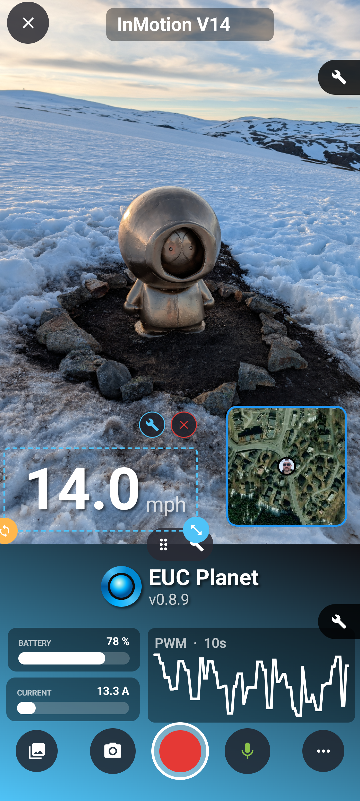 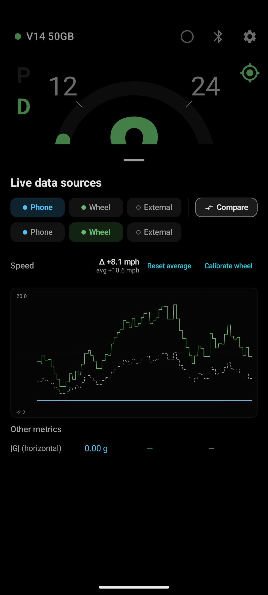

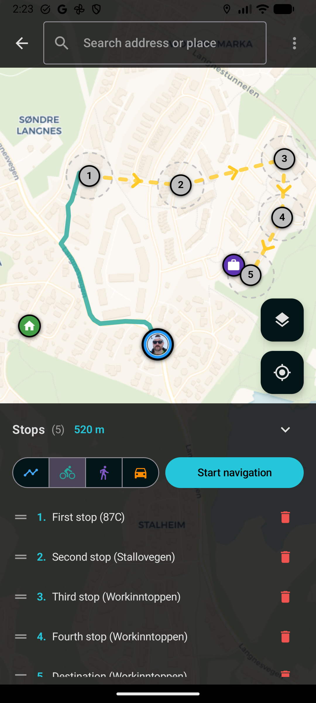 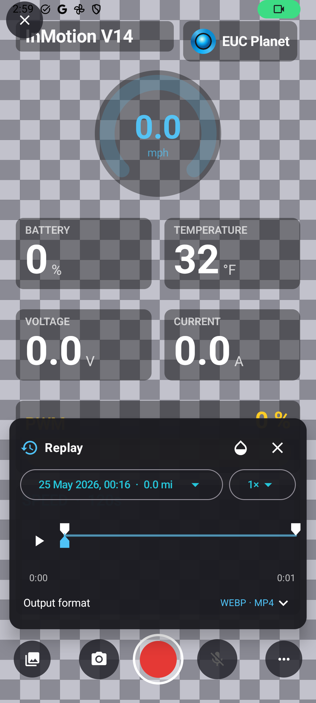 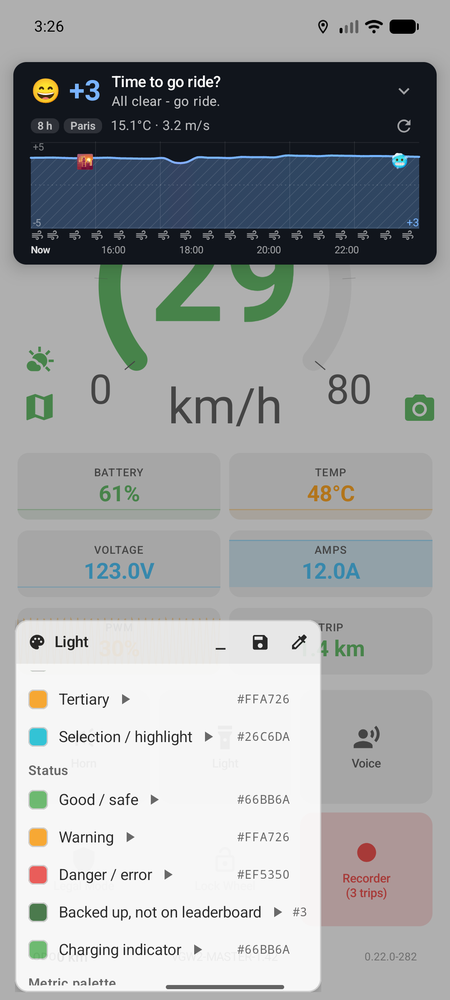 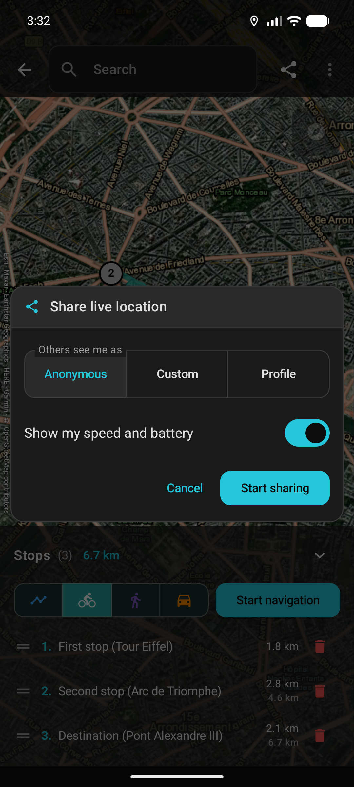

<table>
<tr>
<td align="center">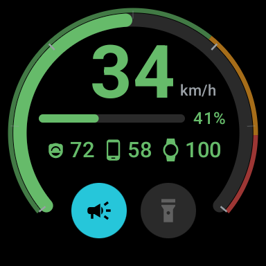<br><sub>Speed dial</sub></td>
<td align="center">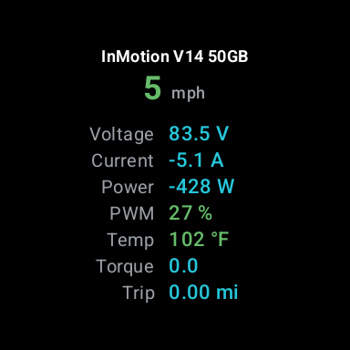<br><sub>Telemetry</sub></td>
<td align="center">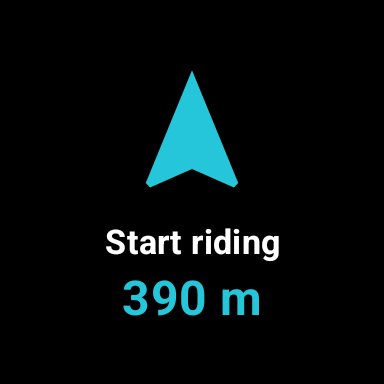<br><sub>Navigation</sub></td>
<td align="center">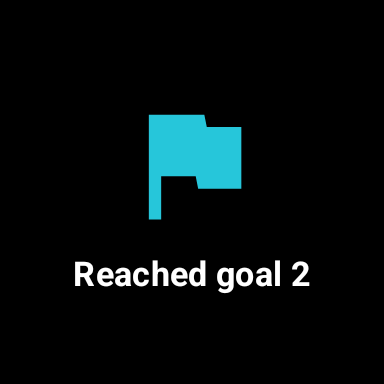<br><sub>Arrival flag</sub></td>
<td align="center">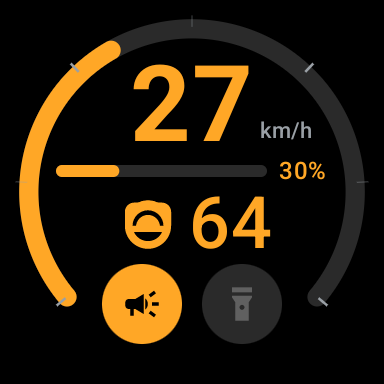<br><sub>One battery</sub></td>
</tr>
</table>

---

## Features

The same twelve as on [eucplanet.ried.no](https://eucplanet.ried.no/), with the
details under each.

**Works with your wheel.** InMotion V14 and P6 verified. KingSong, Begode,
Veteran (LeaperKim), NOSFET and more InMotion models are rider-tested, the rest
of those families and Ninebot in preview. The full list is in
[What wheels work?](#what-wheels-work).

**Modern & fast.** A pure-black dashboard with almost no lag, built to be read
in one glance at speed. Reorder the tiles, theme every color, and it adapts to
portrait, bar-mount landscape, tablets and foldable cover screens.
- Live speed, battery, voltage, amps, temperature, PWM and distance. Composite
  tiles, action groups and a runtime clock; tap any tile for its history graph.
  Metric or imperial.
- Every screen fits its device: a portrait glance view, a three-column landscape
  for bar mounts, roomier tablets, and a cover-screen mode for foldables (the
  Galaxy Z Flip outer display and friends). Rotation is per screen, so the
  dashboard can stay portrait while the map goes landscape.
- Home screen widgets for wheel numbers and one-tap buttons, and for the
  weather.

**Record and compare.** Every ride is recorded with GPS and wheel telemetry, in
a CSV format other EUC apps and tools can read. Open any trip for its graphs, or
let Compare put two rides side by side.
- DarknessBot-compatible CSV, auto-record, a live track preview, and quick export
  and share. A ride is recovered even if the app is closed mid-ride.
- Look at trips later in the [web Trip Viewer](https://eucviewer.ried.no/).

**Charging, cell by cell.** A live charge curve with a prediction line. On wheels
with a smart BMS, a per-cell view shows cell voltages, pack imbalance and
temperatures, so a weak cell shows up early.
- Energy split into used and charged, and a scrubbable prediction line.
- Alerts when the pack passes 80%, when it is full, and at a storage level you
  pick.

**Navigation, offline too.** Multi-stop routes with turn-by-turn guidance. Bike
routes prefer quiet streets, and a missed turn gets a new route in seconds.
Download the areas you ride and the map, routes and turn cues keep working with
no signal.
- Walk, bike, car or straight-line routing, voice cues, and a Treasure Hunt
  proximity mode for unmarked spots.
- The navigator view keeps the turn card, speed, arrival time and your own tiles
  over a map that turns with you.
- GPX tracks are ridden as drawn. Put many stops in the shortest order,
  reverse a route for the way back, or tap the route to add a detour around sand,
  gravel or the wrong side of a one-way.
- Charging stations (connectors, power, cost, ratings and photos) and other places
  along the way (food, shops, rest stops) sit right on the map.
- Share a route as a QR code or a link, nothing uploaded: a friend scans it into
  their app, or opens it in a browser for the stops and a GPX.
- Offline data comes from our own [mirror](https://github.com/eried/eucplanet-maps).
  Map styles include Satellite hybrid, with road and place names over the imagery.

**Watch and helmet.** <sub>Android only</sub> Your wheel's numbers off the phone:
watch apps for Wear OS, [Garmin](https://apps.garmin.com/apps/14c2d086-fcb5-4042-bd5b-034519d18a71) (watches and Edge)
and Amazfit, and a [MotoEye or any Android helmet HUD](https://eucplanet.ried.no/hud/),
also in Android Auto mode with the route.
- **Wear OS** (3 or newer): speed dial, your batteries, horn and light
  remotes, the next turn and a map. Ridden with a Galaxy Watch Ultra, Galaxy
  Watch 5 Pro and TicWatch 3 Pro. Architecture in [docs/WEAR_OS_MAP.md](docs/WEAR_OS_MAP.md).
- **Garmin**: a Connect IQ watch app with speed, battery, PWM, current and motor
  temperature, on most modern Garmin watches and on Edge. Build it
  yourself from [docs/GARMIN_SETUP.md](docs/GARMIN_SETUP.md).
- **Amazfit (Zepp OS)**: speed gauge, PWM, your batteries, horn and light
  remotes, the next turn and the physical buttons. Tested on the T-Rex 3, built
  for the Balance too. Setup in [docs/AMAZFIT_SETUP.md](docs/AMAZFIT_SETUP.md).
- **Helmet HUD**: the dashboard mirrors to a MotoEye E6 or any Android HUD over
  local WiFi, with a Map + Nav screen that puts the route arrow over a moving map.
  The phone updates the HUD app for you after the first install.
- **ENGO 2 and ENGO 3 glasses**: pick a layout and what each place shows, as a
  number, a bar or a graph, with the next turn while you navigate.
- **Android Auto**: turn-by-turn on an Android Auto HUD, your numbers beside the
  map, and alarms as cards.

**Alarms & voice.** Alarms and spoken reports for speed, battery and PWM, the
number that says how close the wheel is to its limit, in your language. Ask for
battery or speed by voice, or say horn, lights, lock.
- Your own thresholds on speed, battery, temperature, PWM, voltage, current, tire
  pressure and more, for every wheel or only the connected one. Each can beep
  (your tone and pitch), speak (`"Battery at {value}%"`) and vibrate, with
  cooldowns so they don't nag. Predictive triggers warn a few seconds ahead, and
  Battery (est) takes the load sag out so it does not fire on every acceleration.
- Spoken reports at your interval with a per-language voice, plus callouts for
  lock, lights, GPS fix, connection, Legal Mode and recording.
- Voice commands <sub>Android only</sub>: ask "battery", "speed" or "how is the
  weather", or have it sound the horn, switch the lights, lock the wheel or start
  recording. Start listening from the Voice button, a Flic, the volume keys (even
  with the screen off), your watch, the HUD or a headset button.
- Engine sounds: an engine whose revs follow the wheel's speed and motor load.

**Overlay Studio.** Record video with your telemetry on screen, laid out your way.
Export MP4 or a transparent overlay for another camera's footage. The same editor
designs your [MotoEye HUD](https://eucplanet.ried.no/hud/) and the Phone HUD
overlay on Android.
- Dials, gauges, rolling graphs, `{speed}`-style text, a mini-map and layered
  cameras. Layouts save as JSON.
- Phone HUD <sub>Android only</sub>: a Studio layout drawn over other apps, so you
  see your wheel while using maps or music.

**Buttons, radar, sensors.** Flic 2 buttons for horn, lights and lock. A Garmin
Varia shows vehicles coming up behind you, with alarms on distance and closing
speed. Bluetooth tire pressure caps and a RaceBox GPS feed the dashboard too.
- Several Flic 2 buttons, and the volume keys <sub>Android only</sub>, for
  horn, lights, lock, voice and more.
- Wheel control one tap away: the horn (the wheel's own, a sound you pick, or
  both), lights and lock. Legal Mode caps the wheel's tiltback and alarm speeds
  and puts your own back when you switch it off.
- Varia RTL515 or RCT715 radar: approaching vehicles on the dashboard, with
  alarms that beep, speak or vibrate.
- Tire pressure: an InMotion P6 relays its own sensor. Any other wheel can use a
  screw-on [valve-cap sensor](https://s.click.aliexpress.com/e/_c2xLwuvt) from the
  Wicarlink family (LY TPMS, ITPMS and unbranded), format in
  [docs/protocols/wicarlink-tpms.md](docs/protocols/wicarlink-tpms.md). One cap per
  wheel, with a low-pressure alarm in psi or bar.
- External Bluetooth GPS (RaceBox or compatible) for centimetre-class speed and
  altitude without draining the phone, falling back to the phone GPS.

**Group rides.** Share a ride with a link or a QR code and see friends live on
the map, with trails. End-to-end encrypted, with a web page for watching without
the app. Opt in to the [EUC Stats leaderboard](https://eucstats.ried.no/) to see
how your distance ranks worldwide.
- Each friend gets a colour and a fading trail; the relay only passes sealed
  packets along.
- The leaderboard ranks riders worldwide and by country.

**Weather forecast.** A score for how the next hours look for riding, from rain,
wind and gusts, cold, heat and night, weighted by how much you mind each one.
- Drag the curve to read any hour, with temperature, wind and humidity underneath.
- Pick the window (the next hours, tomorrow, the week), the source and your comfort
  thresholds. Golden hour counts too.
- Home screen widgets: one cell for right now, and a resizable forecast that
  shows more as you make it bigger.

**Private, and yours to tune.** No analytics, no beacons, no in-app call-home.
Rides stay on your device, with optional Dropbox backup to your own folder.
- Every ride is a plain CSV on your phone. Dropbox sync mirrors trips, settings,
  themes and overlays into your own private folder, and you can hand out a single
  ride as a link when you want to.
- Automations: the headlight turns on before sunset and off after sunrise from
  live GPS (midnight sun and polar night included, I live in the arctic circle 🧐),
  and dims when you slow to walking pace. Phone volume follows speed
  <sub>Android only</sub>, and the wheel locks when you walk away and unlocks when
  you come back. Switch one by hand and it steps aside until you hand it back.
- A dedicated Advanced panel for poll and refresh rates, chart history windows,
  HUD discovery timings, alarm and charging tuning and more. Each has a default,
  a valid range and a one-tap restore.
- In your language, the whole app, with regional versions where riders asked for
  them: English (US and UK), Spanish (Spain and Latin America), Portuguese
  (Brazil and Portugal), and Simplified and Traditional Chinese. English only by
  design: the Garmin and Amazfit apps, the helmet HUD, the ENGO glasses page and
  Service Mode.

---

## Where do I get it?

[Google Play](https://play.google.com/store/apps/details?id=com.eried.eucplanet) has
a small symbolic price, treat it as a tip if you'd like to support the project and
get automatic updates. Or grab the latest APK from [releases](../../releases) for
free and sideload it. Same app either way.

On an iPhone, the app is in beta: join it on
[TestFlight](https://testflight.apple.com/join/8VrhGCrm). It is the same app;
the few things marked <sub>Android only</sub> above are not on the iPhone yet.

On a Garmin watch or Edge, install the EUC Planet app straight from the
[Connect IQ Store](https://apps.garmin.com/apps/14c2d086-fcb5-4042-bd5b-034519d18a71).
On an Amazfit watch, follow [docs/AMAZFIT_SETUP.md](docs/AMAZFIT_SETUP.md).

Build from source:

```bash
./gradlew assembleDebug
adb install app/build/outputs/apk/debug/phone-debug.apk
```

Needs Android 10 (API 29) or newer, or iOS 15 or newer on an iPhone, and a
supported wheel.

---

## Why does this exist?

I got tired of:

- apps that look like they were built in 2014,
- waiting forever for fixes or improvements,
- inflexible developers over just bad designs,
- apps that call home and spy on you.

## Contributing

The BLE layer is separate from the UI. Each brand family has its own `WheelAdapter`
in [`app/src/main/java/com/eried/eucplanet/ble/`](app/src/main/java/com/eried/eucplanet/ble/),
and `CompositeWheelAdapter` routes by the advertised BLE name at connect time. Specs
live in [`docs/protocols/`](docs/protocols/).

To add a wheel: implement `WheelAdapter` (parser plus commands), register it in
`CompositeWheelAdapter`, add the BLE-name pattern to `BleScanner`. The
[BLE capture guide](docs/BLE_CAPTURE_GUIDE.md) is the fast path; one labelled ride is
usually enough. If a supported wheel misbehaves instead, the
[in-app diagnostics guide](docs/DIAGNOSTICS_GUIDE.md) walks owners through sending a
Service Mode recording.

PRs welcome. Bugs go to [Issues](../../issues). Live discussion is on
[Telegram](https://t.me/EUCPlanetApp).

## Support

EUC Planet is free and stays free. If it saved you a subscription, or for any other
reason you want to chip in: [donate via PayPal](https://www.paypal.com/donate/?hosted_button_id=AEB2RPZHNRTKG).
Entirely optional, very appreciated.

## Acknowledgements

Thanks to the people and projects that helped, kept in sync with the app (tap version number → **Thanks**):

| Who | For |
| --- | --- |
| [Gio (Wheel In Motion)](https://www.youtube.com/@RealWheelInMotion) | Promotion, suggestions and P6 testing |
| FlyboyEUC (Adam) | Mten3, E20 and EX30 testing |
| Soolek | KS-16X testing |
| Jonathan Wiesner | LeaperKim Lynx S testing |
| Felix K | LeaperKim Oryx testing |
| Bearkat713 | Motoeye E6 testing |
| [PhilDaintree](https://github.com/PhilDaintree) | KS-18XL testing and the BLE captures behind the KingSong lock and horn |
| [elektro-NIK](https://github.com/elektro-NIK) | Garmin watch testing across nine builds, with the logs that pinned the pacing bug |
| [jeronimo701](https://github.com/jeronimo701) | KingSong S22 report and patch that led to battery percent from voltage |
| [jforssblad](https://github.com/jforssblad) | NOSFET Aeon cell-voltage testing |
| [Dubardo](https://github.com/Dubardo) | Odometer-in-trip bug report |
| [Amoenus](https://github.com/Amoenus) | NOSFET Aeon alarm-speed mapping and headlight level readback, decoded from his own BLE captures and contributed with tests and protocol notes. The first code contributed from outside. |
| [Reimus](https://github.com/Reimus) | Sherman Max compatibility |
| [ZiraiMode](https://github.com/ZiraiMode) | The Wear OS map: tile streaming from the phone and the watch-side drawing, tested on a Galaxy Watch 5 Pro with a Lynx S |
| Klaus | InMotion V6 testing: tilt-back and the bigger watch layout, on a TicWatch 3 Pro and a Fenix 5S |
| Ilya Shkolnik | Advice and help. Maintains DarknessBot. |
| [InMotion](https://inmotion-store.com/product/inmotion-v14/) | For making a great V14 |
| [WheelLog community](https://github.com/Wheellog/wheellog.android) | Open-source (GPLv3) reverse-engineering of the EUC BLE protocols, used as the reference for every wheel adapter (KingSong, Begode, Veteran, Ninebot, InMotion). No WheelLog code is reused. |
| [OpenStreetMap contributors](https://www.openstreetmap.org/copyright) | The map data under every layer in the app (ODbL) |
| [CyclOSM](https://www.cyclosm.org/) | Cycle and trail style, tiles served by OpenStreetMap France |
| [OpenTopoMap](https://opentopomap.org/) | Topographic style with contours (CC-BY-SA) |
| [Humanitarian OSM Team](https://www.hotosm.org/) | HOT style, tiles served by OpenStreetMap France |
| [Esri](https://www.esri.com/) | World Imagery satellite tiles (Esri, Maxar, Earthstar Geographics), the Light and Dark gray basemaps, and the road and place labels of Satellite hybrid |
| [Leaflet](https://leafletjs.com/) | The map component every in-app map is drawn with (BSD-2) |
| [FOSSGIS](https://www.fossgis.de/) | The public Valhalla and OSRM routing servers |
| [BRouter](https://brouter.de/) | Offline routing (MIT) |
| [Protomaps](https://protomaps.com/) | The OpenStreetMap build the offline maps come from |

## License

Released under the [MIT License](LICENSE), use it, fork it, build on it, just keep
the copyright notice. The Flic 2 SDK and other third-party dependencies keep their
own licenses.
